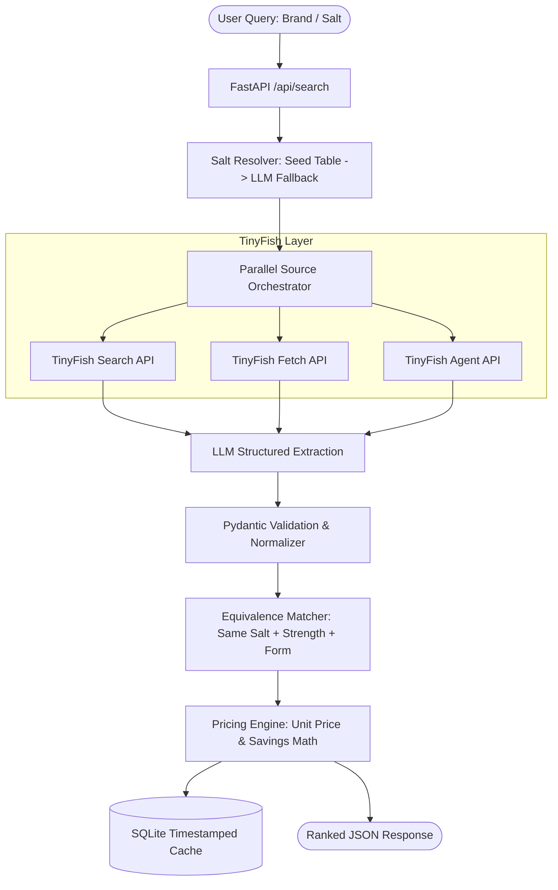

# Dawa Dost Architecture & Technical Design

## 1. Pipeline Overview

## 2. Hard Design Rules
1. **Deterministic Arithmetic**: The LLM NEVER computes unit price, savings, or matching decisions. All arithmetic is in Python (`pricing.py`, `matcher.py`).
2. **Freshness Tracking**: Every listing carries an ISO-8601 `fetched_at` timestamp.
3. **Failure Isolation**: Each source runs in parallel via `asyncio.gather(..., return_exceptions=True)`. Per-source statuses (`ok`, `failed`, `cached`, `blocked`) are reported in the response.
4. **Resilient Caching**: Cached runs can be served transparently, and `USE_CACHE_ONLY=true` serves as a demo fail-safe.
